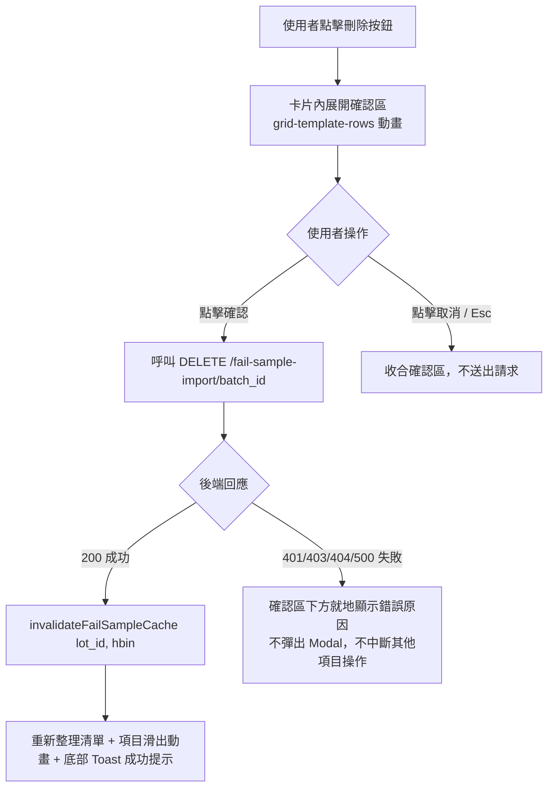
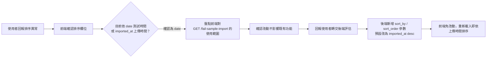

# ACT Failure Analysis System Frontend — 工作紀錄 W45

> 專案名稱：ACT Failure Analysis System Frontend
> 報告期間：2026-10-29 ～ 2026-11-05（W45）
> 負責人：Dante

---

## 任務內容

承接 File Upload v7（#44）之後的收尾工作，完成 v1.6.0 資料上傳頁的最後一塊拼圖
「Fail Sample Import 批次刪除功能」，並處理使用者實測回報的排序問題、補齊測試
覆蓋率缺口，最終將 `Dante-feat-file-upload` 併回 `Dante` 並發布 `v1.6.0`：

1. 依使用者確認的產線檔名規則，修正 Fail Sample Import 檔名驗證補上 `Wafer_ID` 欄位
2. 同步後端契約微調（上傳上限 2 MiB→5 MiB、`rows` API 排序與 `source_file` 驗證行為）
3. 提出並完成「Fail Sample Import 批次刪除」功能（API 草案 → 後端正式 API → 依使用者手稿改版 UI/UX）
4. 調查並確認「已上傳清單未依上傳時間排序」非前端問題，轉交後端修正後完成前端驗證
5. 補齊 `src/api/client.ts`、`src/stores/uploadStore.ts` 測試覆蓋率缺口
6. 合併 `Dante-feat-file-upload` 回 `Dante`，建立 `Dante-release-v1.6.0`，版本號升級至 1.6.0

---

## 技術說明

### 刪除功能操作流程

採用使用者手稿定案的「卡片內就地展開確認」設計，取代初版 `Modal.confirm`：

> 不提供復原（undo）按鈕：誤刪後由產線人員重新上傳即可，延續上傳「不覆蓋、不
> 重試」的既有邏輯（詳見 `design-decisions-qa.md` 條目 24）。

### Fail Sample Import 清單排序問題排查

使用者實測發現清單未按「上傳時間」新到舊排序，前端排查流程與結論：

後端同時以 `batch_id` 做次排序確保分頁穩定，無法解析的 `imported_at` 固定排最後；
`date_from`／`date_to` 篩選仍比對測試時間，行為未變。

### 測試覆蓋率缺口補強

盤點 `client.ts`／`uploadStore.ts` 未覆蓋分支後確認皆為真實業務邏輯（非防禦性或
不可達程式碼，判斷原則詳見 `design-decisions-qa.md` 條目 25），因此採補測試而非
調整門檻：

| 檔案 | 補強內容 |
|------|---------|
| `src/api/client.ts` | 422 陣列 `detail` 解析、錯誤碼/訊息 fallback 邊界、並發 401 刷新佇列（`notifyPending`/`triggerRefresh`）、回應攔截器 catch-all 分支 |
| `src/stores/uploadStore.ts` | `fetchNetlistSheet` 5 個未測分支（含 Stacking_Die/Tray 欄位轉換與 Tray-null 情境）、`fetchNetlistPrograms`／`fetchFailSampleImports` 錯誤路徑、`readFileText` 的 FileReader fallback、上傳進度回呼 |

---

## 成果總覽

| 類型 | 檔案 | 說明 |
|------|------|------|
| 修改 | `src/features/netlist/utils/uploadValidation.ts` | 檔名規則補上 `Wafer_ID` 欄位，接受空值與有值兩種情境 |
| 修改 | `src/stores/uploadStore.ts` | 上傳上限改 5 MiB；新增 `deletingBatchIds` 狀態與 `deleteFailSampleImport` action（回傳 `FailSampleImportDeleteOutcome`） |
| 新增 | `src/api/data.ts` — `deleteFailSampleImport` | 串接 `DELETE /api/v1/data/fail-sample-import/{batch_id}` |
| 修改 | `src/features/netlist/components/UploadedReferenceList.tsx` | 刪除按鈕恆常顯示＋就地展開確認區＋錯誤顯示＋成功滑出動畫 |
| 新增 | `src/components/Toast.tsx` | 共用底部 Toast 通知元件 |
| 修改 | `src/features/netlist/NetlistUploadPage.tsx` | 刪除後頁面退回邏輯，避免停留在空頁 |
| 新增/修改 | `tests/unit/client.test.ts`（+128 行）、`tests/unit/uploadStore.test.ts`（+203 行） | 補齊覆蓋率缺口，176/176 測試通過 |
| 修改 | `docs/api/frontend-contract.md` | 同步上傳上限、rows 排序行為、刪除 API（2.18 節）、清單預設排序變更 |
| 修改 | `docs/decisions/design-decisions-qa.md` | 新增條目 24（刪除功能最終定案）、條目 25（覆蓋率判斷原則） |
| 修改 | `to-do-list.md` | 補齊本週修改紀錄，版本規劃標記 v1.6.0 ✅ |
| 修改 | `package.json`、`package-lock.json` | 版本號 1.5.1 → 1.6.0 |
| 版控 | `reference/UI Design/` | 納入 `.gitignore` 並 `git rm --cached` 既有追蹤檔案（agent 參考用 mockup，不進版控） |

---

## 驗證結果

- `npm run test:run`：176/176 測試通過
- `npm run test:report`：成功產出覆蓋率與測試結果 HTML 報告；`client.ts`
  93.49/88.76/93.75/98.18、`uploadStore.ts` 94.69/70/94.91/98.4
  （statements/branches/functions/lines），均高於門檻 85/65/75/85
- `npm run build`：成功
- `npm run lint`：維持既有 6 errors／8 warnings（皆為本次變更前既存，未新增）
- 分支整併：`Dante-feat-file-upload` → `Dante`（`--no-ff`）；
  `Dante-test-coverage-gaps` → `Dante`（`--no-ff`）；
  `Dante-release-v1.6.0` fast-forward 對齊 `Dante`，均已推送 gitlab

---

## 後續行動

- 待使用者排程將 `Dante-release-v1.6.0` 合併進 `master` 正式上線
- 待後端提供歷史紀錄查詢 API（#12，v1.7.0）後開始歷史紀錄頁開發
- 持續觀察 Fail Sample Import 清單在大量批次下的排序與分頁穩定性
