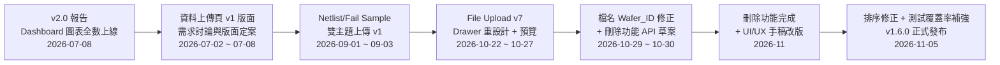
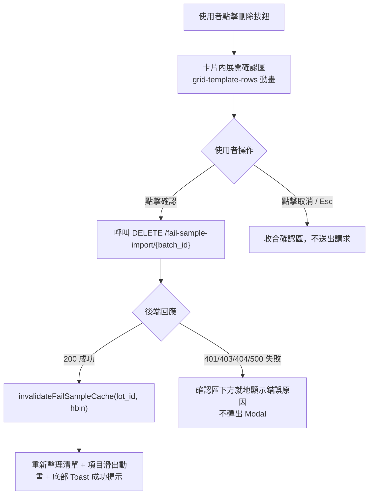
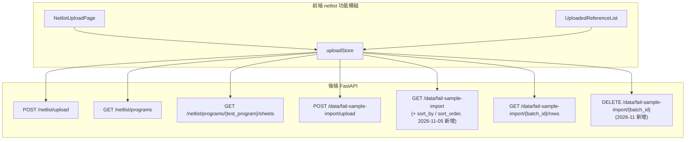

# ACT Failure Analysis System — 網頁開發報告（第三階段：資料上傳頁 v1.6.0）

> 報告日期：2026-11-05
> 撰寫者：Dante
> 版本：v3.0（v1.6.0 資料上傳頁正式發布）
> 承接：`20260708_ACT-Frontend-Report.md`（v2.0，Dashboard 圖表全數上線 + 第三階段規劃）——
> 本報告僅涵蓋 v1.6.0 資料上傳頁相關的新進度（2026-07-08 ～ 2026-11-05），
> 前兩階段已完成內容（登入、LOT 搜尋、Fail Sample List、Dashboard 2×2 圖表、暗／亮主題）
> 請參閱前兩份報告，不重複列出。

---

## 目錄

1. [進度總覽](#一進度總覽)
2. [資料上傳頁功能總覽](#二資料上傳頁功能總覽)
3. [Fail Sample Import 批次刪除功能](#三fail-sample-import-批次刪除功能)
4. [系統架構更新](#四系統架構更新)
5. [測試與品質](#五測試與品質)
6. [下一階段規劃：歷史紀錄頁（v1.7.0）](#六下一階段規劃歷史紀錄頁v170)
7. [附錄：已知限制與待辦事項](#七附錄已知限制與待辦事項)

---

## 一、進度總覽

| 階段 | 期間 | 內容 | 狀態 |
|------|------|------|------|
| 版面設計 | 2026-07-02 ～ 07-08 | 資料上傳頁與歷史紀錄頁需求討論、版面 v1→v2 定案，確認拆為兩個獨立頁面 | ✅ |
| 雙主題上傳 v1 | 2026-09-01 ～ 09-03 | Netlist／Fail Sample 上傳、清單查詢、`uploaded_by` 工號顯示、角色守衛 | ✅ |
| File Upload v7 | 2026-10-22 ～ 10-27 | 右側 Drawer 重設計、每主題獨立佇列、Netlist 六 Sheet 與 Fail Sample rows 明細預覽 | ✅ |
| 批次刪除功能 | 2026-10-29 ～ 11-05 | 需求草案 → 後端正式 API → 使用者手稿 UI/UX 改版（就地展開＋Toast） | ✅ |
| 排序與測試補強 | 2026-11-04 ～ 11-05 | 清單排序問題排查轉交後端修正、測試覆蓋率缺口補齊 | ✅ |
| **v1.6.0 正式發布** | 2026-11-05 | 合併 `Dante-feat-file-upload`／`Dante-test-coverage-gaps` 回 `Dante`，建立 `Dante-release-v1.6.0` | ✅ |

v1.6.0 完整實現 Phase II Roadmap 中「資料上傳頁（Netlist + Fail Sample 雙主題）」
（對應 `to-do-list.md` #11／#44／#45），為資料上傳與歷史紀錄模組的第一個完整
里程碑。

---

## 二、資料上傳頁功能總覽

### 2.1 版面與主題

左欄為主題下拉（`Netlist`／`Fail Sample`）＋已上傳清單（client-side 搜尋，區塊內
捲動）＋固定於左下角的說明欄；中央為拖曳/點選上傳區（支援複選）＋主題專屬警示
＋固定高度的上傳佇列。切換主題會各自保留佇列狀態，不互相清空。

### 2.2 功能矩陣

| 功能 | Netlist | Fail Sample |
|------|---------|--------------|
| 上傳格式 | `.xlsx`（檔名 `NL-{Test_Program}_({Security}).xlsx`） | `.json`（檔名 `{Test_Program}_{Lot_ID}_{Wafer_ID}_{AT\|RT}_{14位數字}.json`，`Wafer_ID` 可為空） |
| 單檔上限 | 5 MiB（2026-10-29 由 2 MiB 調整） | 5 MiB |
| 清單顯示 | `uploaded_by` 工號、上傳時間、安全等級 | `uploaded_by` 工號、`imported_at`（上傳時間，預設排序）、`test_program`／`lot_id` |
| 內容預覽 | 六個固定 Sheet（Netlist／Test_Spec／Bin_Priority／Bin_Name／Stacking_Die／Tray）列數 metadata + 懶加載內容 | `rows` 明細（Site 複選、12 欄位搜尋／排序、後端分頁、查詢快取） |
| 批次刪除 | ❌（Netlist 為覆蓋式更新，無需刪除） | ✅（詳見第三節） |

### 2.3 錯誤處理

後端巢狀業務錯誤碼（`detail.code`／`detail.message`）統一由
`getApiErrorCode()`／`getApiErrorMessage()` 解析，涵蓋 `1007`（格式錯誤）、
`1011`（超過大小上限）、`1012`（檔名格式錯誤）。佇列中失敗項目**不提供重試**，
需重新選檔。

---

## 三、Fail Sample Import 批次刪除功能

### 3.1 設計脈絡

由於 Fail Sample Import 的上傳邏輯為「不覆蓋、每次另存一筆」，誤傳的批次無法用
重新上傳覆蓋修正，因此需要獨立的刪除能力。此功能歷經三個階段定案：

1. 前端提出 API 需求草案（含假設的錯誤碼結構）
2. 後端提供正式 API（細節與草案有出入，如 404 為純字串而非結構化 `code`）
3. 使用者提供手稿，要求將初版 `Modal.confirm` 改為卡片內就地展開確認＋Toast

完整決策脈絡見 `docs/decisions/design-decisions-qa.md` 條目 24。

### 3.2 操作流程

### 3.3 權限與復原策略

| 項目 | 決策 |
|------|------|
| 可刪除範圍 | `engineer`／`admin` 皆可刪除**任一**批次，不限上傳者本人 |
| 復原機制 | 不提供（誤刪由產線人員重新上傳即可） |
| 快取影響 | 後端清除 `rows` 快取；`hbin=3` 批次另清 IO／POWER 分析快取。前端仍主動呼叫 `invalidateFailSampleCache` 確保 Dashboard 端同步失效 |

---

## 四、系統架構更新

相較於 v2.0 報告，前端新增／調整以下 API 串接（詳見
`docs/api/frontend-contract.md`）：

`GET /data/fail-sample-import` 的排序行為於 2026-11-05 由後端修正：預設改為
`imported_at` 由新到舊排序（原本依 `date` 測試時間排序），並新增可選參數
`sort_by`（`imported_at`／`date`）與 `sort_order`（`asc`／`desc`）；前端呼叫方式
不變，重新載入即自動依上傳時間排序。

---

## 五、測試與品質

| 項目 | 結果 |
|------|------|
| 單元／元件測試 | 176/176 通過（`npm run test:run`） |
| 覆蓋率（`src/api/client.ts`） | statements 93.49 / branches 88.76 / functions 93.75 / lines 98.18（門檻 85/65/75/85） |
| 覆蓋率（`src/stores/uploadStore.ts`） | statements 94.69 / branches 70 / functions 94.91 / lines 98.4（門檻 85/65/75/85） |
| `npm run build` | 成功 |
| `npm run lint` | 6 errors／8 warnings，皆為既存問題，本次無新增 |

覆蓋率缺口的判斷原則（何時補測試、何時可接受較低覆蓋率）已整理為
`design-decisions-qa.md` 條目 25，供未來版本參考。

---

## 六、下一階段規劃：歷史紀錄頁（v1.7.0）

資料上傳頁（v1.6.0）完整功能到位後，下一個 Phase II 版本為歷史紀錄頁
（`to-do-list.md` #12），範疇涵蓋登入／上傳／使用狀況三主題通用查詢頁。目前
版面 v2 已確認，**待後端提供全新歷史紀錄查詢 API** 後開始實作；Fail Sample
詳情檢視與 CSV 匯出功能亦規劃併入此頁。

---

## 七、附錄：已知限制與待辦事項

- Netlist 上傳為覆蓋式更新，無批次刪除需求，本階段未提供對應功能。
- Fail Sample Import 刪除為硬刪除且不可復原，需使用者在刪除前自行確認批次內容
  （可透過 `rows` 明細預覽確認後再刪除）。
- 歷史紀錄頁（#12）與 ACT Dashboard 模組移植（#29～#42，v2.0.0）仍待後端對應
  API 就緒後開工，詳見 `to-do-list.md` 版本規劃（Phase II Roadmap）。
